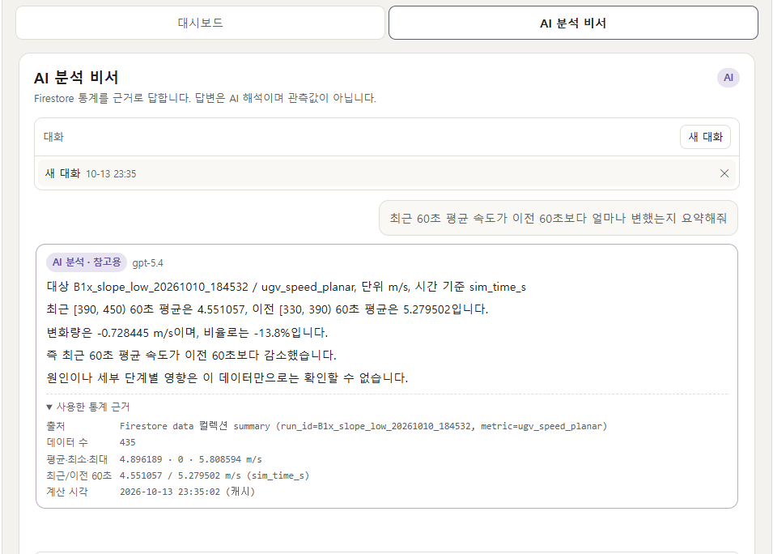
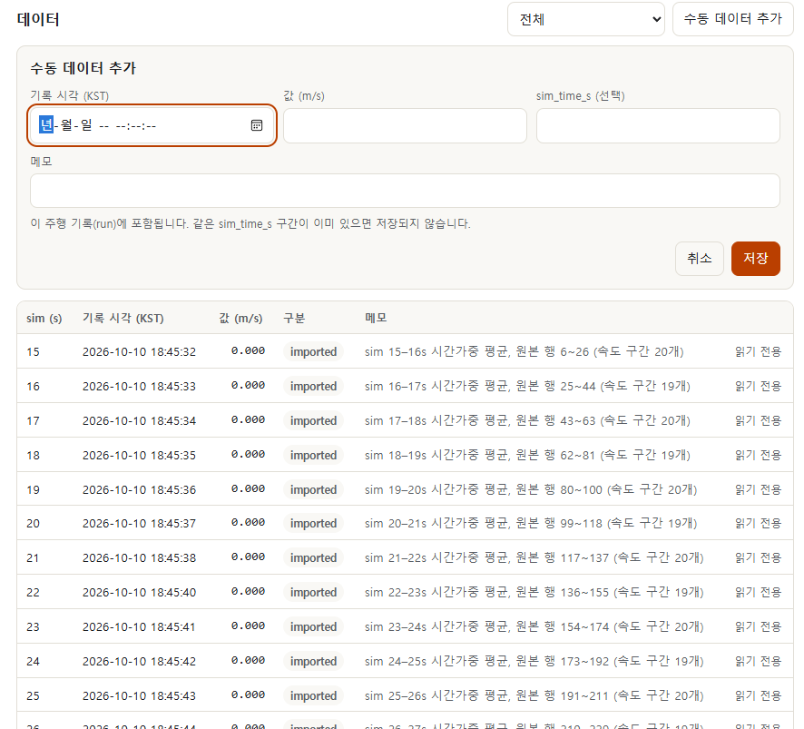
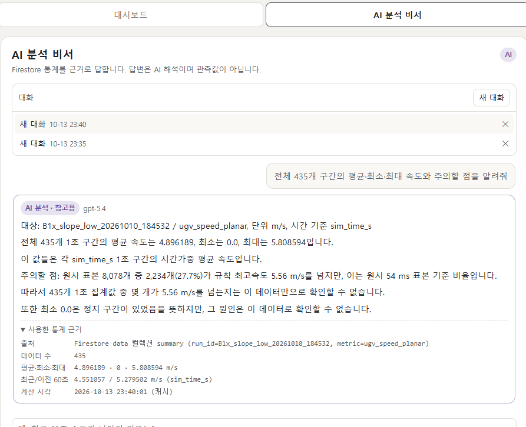

# ADAIR Mission Intelligence

### AI 기반 산불재난대응 통합 임무 분석 비서

## 프로젝트 소개

ADAIR 산불재난대응 프로젝트에서 생성된 실제 시뮬레이션 및 테스트 데이터를 활용하여 UAV, UGV, 오케스트레이터의 운영 정보를 분석하는 AI 비서 웹 애플리케이션입니다.

코디세이 「AI Agent 개발: 나만의 AI 비서 구축」 과제로 개발하며, 향후 다중 무인체계의 임무 수행 결과와 운영 상태를 통합 분석하는 서비스로 확장하는 것을 목표로 합니다.

## 배포 주소

| 구분 | 주소 |
|---|---|
| GitHub 저장소 | https://github.com/sujinpark50-gif/ia-codyssey (이 프로젝트는 `mission M1-2/` 폴더) |
| 프론트엔드 (Vercel) | https://adair-mission-intelligenceweb.vercel.app |
| 백엔드 API (Render) | https://adair-mission-intelligence.onrender.com |
| Swagger 문서 | https://adair-mission-intelligence.onrender.com/docs |

- 로그인(Google)과 허용된 계정(`ALLOWED_EMAILS`)이 있어야 데이터와 AI 비서를 쓸 수 있습니다. Swagger 문서는 공개이지만, 보호 API는 Firebase ID 토큰이 없으면 401을 반환합니다.
- 제약과 주의할 점은 아래 "운영상 제한사항"에 있습니다. 배포 구조와 절차는 `docs/DEPLOYMENT.md`에 있습니다.

## 시스템 아키텍처

```
브라우저 ── 정적 화면 ── Vercel (web/: HTML·CSS·JS, 빌드 시 API_BASE_URL 주입)
   │
   │ Firebase Google 로그인 → ID 토큰
   │
   └─ HTTPS + Authorization: Bearer <ID 토큰> ──▶ Render (FastAPI)
                                                  ├─ CORS: Vercel 운영 도메인만 허용
                                                  ├─ 토큰 검증 + 허용 계정(ALLOWED_EMAILS) 확인
                                                  ├─ Firestore (서비스 계정, 최소 권한): data · conversations · usage
                                                  └─ GPT (Codyssey OpenAI 호환 API, gpt-5.4)
```

- 화면은 Render API를 직접 호출합니다. Vercel에는 서버 코드나 프록시가 없습니다.
- 브라우저는 Firestore에 직접 접근하지 않습니다(`firestore.rules`가 모두 거부). 모든 읽기·쓰기는 백엔드를 거칩니다.
- Render 주소로 접속해도 같은 화면이 같은 출처로 동작합니다(로컬 실행과 같은 방식).

## 스크린샷

**AI 비서 — Firestore 통계를 근거로 한 답변**



**데이터 관리 — 수동 데이터 추가와 목록 (원본 435건은 읽기 전용)**



**대화 기록 — 새로고침 후 목록과 대화 다시 불러오기**



## 주요 기능

**1차 개발 — 코디세이 과제**

- UGV 주행 속도 시계열 분석
- 평균·최대·최소 및 구간별 변화 분석 (최근 60초 vs 이전 60초, 최근 추세 증가·감소·유지)
- GPT 기반 데이터 질의응답
- Firestore 데이터 관리 및 대화 기록 저장
- 웹 기반 AI 비서 인터페이스

**향후 확장**

- UAV 비행 및 정찰 데이터 분석
- UGV 출동·복귀 및 주행 결과 분석
- 오케스트레이터의 임무 단계별 이벤트 분석
- 통합 임무 성공·실패 이력 비교
- 반복 오류 및 운영 병목 분석

## 데이터

ADAIR 프로젝트의 Gazebo·PX4 시뮬레이션 및 테스트 로그를 활용합니다.

1차 데이터는 실제 UGV 주행 기록에서 계산한 속도 시계열이며, 원본 검증과 정규화를 마쳤습니다(M1-2).

향후 UAV, UGV, 오케스트레이터 로그를 검증하여 통합 데이터셋으로 확장할 계획입니다.

## 기술 스택

- **Backend:** Python, FastAPI
- **Database:** Firebase Firestore
- **AI:** OpenAI 호환 GPT API (Codyssey, `gpt-5.4`)
- **Auth:** Firebase Authentication (Google 로그인), 서버에서 ID 토큰 검증
- **Frontend:** HTML, CSS, JavaScript (프레임워크 없음)
- **Deployment:** Render (백엔드), Vercel (프론트엔드)

## 개발 단계

1. UGV 시계열 데이터 검증 및 정규화
2. 데이터베이스 및 API 구현
3. GPT 기반 분석 비서 구현
4. 웹 인터페이스 및 배포
5. UAV·UGV·오케스트레이터 통합 분석 확장

## 프로젝트 목표

단일 차량의 성능 분석을 넘어, 다중 무인체계의 임무 수행 과정에서 발생하는 데이터를 통합하고 AI를 통해 운영 결과를 이해할 수 있는 분석 기반을 구축합니다.

현재는 코디세이 과제의 필수 기능을 구현해 운영 배포까지 마친 단계(M1~M6)이고, UAV·오케스트레이터 데이터 통합은 아직 시작하지 않았습니다.

## 현재 구현 상태

| 단계 | 내용 | 상태 |
|---|---|---|
| M1-2 | 원본 검증, 속도 재계산, 1초 시계열 435개 생성 | 완료 — `docs/DATA_VALIDATION.md` |
| M2 | FastAPI 데이터 API, 저장소 계층(메모리·Firestore), 적재기, 통계 요약 | 완료 — 실제 Firestore `data` 컬렉션에 435건 적재·검증 (2026-10-13) |
| M3 | GPT 분석 비서 `POST /api/chat`, 대화 기록 API, 통계 캐시 | 완료 — 운영에서 GPT 답변·대화 저장·복원 확인 (`docs/CHAT.md`) |
| M4 | 웹 화면(대시보드·AI 비서·대화 기록), Firebase 로그인, 소유권, 호출 제한 | 완료 — 운영에서 로그인 확인 (`docs/SECURITY_M4.md`) |
| M5 | Render 배포, 최소 권한 계정, 보안 점검, 읽기 최적화 | 완료 — https://adair-mission-intelligence.onrender.com (`docs/DEPLOYMENT.md`) |
| M6 | 프론트엔드 Vercel 분리(Render API 직접 호출·CORS), Swagger 공개, 최근 추세, 잠든 서버 안내 | **완료** — 운영 검증 2026-10-13 (`docs/DEPLOYMENT.md`, `docs/submission/CHECKLIST.md`) |

## 폴더 구조

```
mission M1-2/
├─ app/                 FastAPI 앱 (config, models, repository, service, importer, llm, chat, conversations, auth, ratelimit, api/)
├─ scripts/
│  ├─ prepare_data.py   원본 → 1초 시계열 (표준 라이브러리만)
│  ├─ load_data.py      1초 시계열 → 저장소 적재 (기본: 메모리 모의 적재)
│  ├─ check_firestore.py Firestore 연결 확인
│  ├─ check_llm.py      GPT API 연결 확인 (실제 호출 1회)
│  └─ e2e_chat.py       채팅·대화 저장 통합 확인 (실제 호출 1회)
├─ data/
│  ├─ raw/              원본 CSV·JSON (커밋하지 않음, 직접 준비)
│  ├─ ugv_speed_1s.csv / .json, source_manifest.json, validation_summary.json
├─ web/                 웹 화면 (index.html, styles.css, app.js, config.js — 비밀값 없음)
│                       build.mjs·vercel.json: Vercel 빌드 (API_BASE_URL → dist/env-config.js)
├─ docs/                DATA_VALIDATION.md, DATA_SCHEMA.md, API.md, CHAT.md, SECURITY_M4.md, DEPLOYMENT.md
│  └─ submission/       제출 체크리스트, 스크린샷
├─ render.yaml          Render 배포 설정 (Blueprint, 비밀값 없음)
├─ firestore.rules      Firestore 보안 규칙 (클라이언트 접근 모두 거부)
└─ tests/               test_prepare_data.py (M1-2), test_api.py (M2), test_chat.py (M3), test_auth_ui.py (M4), test_deploy.py (M5), test_m6.py (M6)
```

명령은 모두 `mission M1-2` 폴더에서 실행합니다.

## 1. 원본 파일 준비

원본은 ADAIR 저장소의 `logs/ugv/`에 있습니다. 두 파일을 `data/raw/`에 복사하고 해시를 확인합니다.

```bash
mkdir -p data/raw
cp <ADAIR 경로>/logs/ugv/B1x_slope_low_20261010_184532.csv  data/raw/
cp <ADAIR 경로>/logs/ugv/B1x_slope_low_20261010_184532.json data/raw/
sha256sum data/raw/*      # PowerShell: Get-FileHash data/raw/*
```

| 파일 | SHA-256 |
|---|---|
| `B1x_slope_low_20261010_184532.csv` | `4d18f3d45101cbd68ff85d39632e6355c7f6603caf9b2963d7bd5efb7583d4c8` |
| `B1x_slope_low_20261010_184532.json` | `4fa14bd41bfb4b74bd25a293c0cd1ccf219b88f559674cb0d8ea978f2a4e22bf` |

해시가 다르면 다른 파일입니다. 데이터 생성과 M1-2 테스트가 실패합니다.

## 2. 환경 준비

```bash
python -m venv .venv                                         # Python 3.10 이상 (운영은 3.12)
.venv/Scripts/python -m pip install -r requirements.txt     # macOS/Linux: .venv/bin/python
cp .env.example .env                                         # 필요할 때만
```

아래 명령의 `python`은 가상환경의 Python입니다. 먼저 활성화하세요(PowerShell `.venv\Scripts\Activate.ps1`, Git Bash `source .venv/Scripts/activate`, macOS/Linux `source .venv/bin/activate`).

## 3. 데이터 생성 (M1-2)

```bash
python scripts/prepare_data.py
```

`data/ugv_speed_1s.csv`, `ugv_speed_1s.json`, `source_manifest.json`, `validation_summary.json`을 다시 만듭니다. 같은 원본이면 바이트까지 같은 결과가 나옵니다. 원본 파일은 읽기만 합니다.

## 4. 테스트

```bash
.venv/Scripts/python -m unittest discover -s tests -v
```

- `test_prepare_data.py` 12개: 원본 품질, 속도 계산, 집계, 재현성, 원본 해시. **`data/raw/`에 원본이 있어야 합니다.**
- `test_api.py` 23개: API 동작, 수정 정책, 통계 검산, 중복 적재 방지, Firestore 장애 처리, CORS, Swagger. Firestore 연결이나 원본 없이 돌아갑니다.
- `test_chat.py` 19개: 채팅, 대화 기록, GPT 오류·저장 실패 처리, 통계 프롬프트, 근거 검사, 키 노출 방지, Codyssey 호환 요청 형식. 가짜 GPT·가짜 전송 계층을 쓰며 실제 API를 부르지 않습니다.
- `test_auth_ui.py` 19개(M4: 로그인·허용 계정·소유권·호출 제한), `test_deploy.py` 10개(M5: 배포 설정·키 노출 방지), `test_m6.py` 18개(M6: CORS, Swagger 공개 범위, 최근 추세 경계값, Vercel 빌드, 정적 파일 비밀값 검사). `test_m6.py`의 빌드 테스트는 Node.js가 없으면 건너뜁니다.

### 테스트 결과 (2026-10-13)

전체 101개 통과 (Python 3.12.14, Node.js 24.18.0, `data/raw/` 원본 있음). 실제 Firestore·GPT를 부르지 않는 자동 테스트입니다. 운영 환경 검증 결과(CRUD, GPT, 대화 복원, 인증 401, CORS, Swagger 비밀값 점검)는 `docs/DEPLOYMENT.md`의 "8단계 운영 검증"과 `docs/submission/CHECKLIST.md`에 있습니다.

## 5. API 실행

```bash
.venv/Scripts/python -m uvicorn app.main:create_app --factory --reload
```

- Swagger: http://127.0.0.1:8000/docs (`DOCS_ENABLED` 기본값 true)
- 기본(`DATA_BACKEND=memory`)은 시작할 때 435개를 메모리에 적재하고, 종료하면 변경 내용이 사라집니다.
- `/health`, `/api/config` 외의 API는 로그인이 필요합니다. 실제로 호출하려면 8절의 Firebase 설정과 `ALLOWED_EMAILS`가 있어야 합니다. 토큰이 없으면 401, `FIREBASE_PROJECT_ID` 없이 토큰을 보내면 503(`AUTH_UNAVAILABLE`)입니다.
- 엔드포인트와 응답 형식은 `docs/API.md`에 있습니다.

## 6. Firestore 연결과 적재

`.env`에 `DATA_BACKEND=firestore`, `GOOGLE_APPLICATION_CREDENTIALS` 또는 `FIREBASE_CREDENTIALS`(저장소 밖 키 경로, 둘 중 하나), `FIREBASE_PROJECT_ID`, `FIRESTORE_DATABASE_ID`를 넣은 뒤 순서대로 실행합니다.

```bash
python scripts/load_data.py                                       # 1. 모의 적재 (메모리, 쓰기 없음)
python scripts/check_firestore.py                                 # 2. 연결 확인: 인증, data 접근, 임시 문서 생성·조회·삭제
python scripts/load_data.py --backend firestore --confirm-upload  # 3. 실제 적재 + 검증 (승인 후에만)
python scripts/load_data.py --backend firestore --confirm-upload  # 4. 재적재: created=0, unchanged=435 이어야 함
python scripts/load_data.py --backend firestore --verify-only     # 쓰기 없이 검증만
```

적재 후 검증 항목: imported 문서 수 435, 문서 ID 집합 일치, 날짜·값·단위·원본 식별자 보존, 평균 4.896189·최소 0·최대 5.808594 (오차 1e-6).

키 파일 내용과 private key는 출력·로그·API 오류 응답에 나오지 않도록 지웁니다(`app/repository.py`의 `safe_error`).

## 원본 데이터 정책

- 원본 CSV·JSON은 **읽기 전용**입니다. 스크립트는 원본을 읽기만 하고, 실행 전후 해시가 같은지 확인합니다.
- 원본은 이 저장소에 **커밋하지 않습니다** (`.gitignore`의 `data/raw/`).
- Firestore의 `imported` 데이터(원본에서 계산한 435개)는 API로 수정·삭제할 수 없습니다. 서버가 403으로 거부합니다. 추가·수정·삭제는 `manual` 데이터만 가능합니다.
- 이 저장소는 공개 저장소입니다. 원본에서 계산한 파생 산출물(1초 속도값, 원본 행 번호, 파일 해시, 시험 식별자·월드·차량 이름)은 저장소에 포함되어 있습니다. 소유자가 공개해도 된다고 판단했습니다(2026-10-13).
- API 키, 서비스 계정 키, `.env`는 커밋하지 않습니다.

## 7. GPT 분석 비서 (M3)

`.env`에 `OPENAI_API_KEY`, `OPENAI_MODEL=gpt-5.4`, `OPENAI_BASE_URL=https://copa.codyssey.kr/v1`을 넣습니다. 서버를 실행한 뒤 `POST /api/chat`으로 질문합니다. 요청 1회가 GPT 호출 1회(유료)입니다. 자세한 내용은 `docs/CHAT.md`.

### GPT 분석 방식

1. 질문이 오면 서버가 `GET /api/data/summary`와 같은 통계를 계산합니다(60초 캐시). 통계에는 데이터 수, 기간, 평균·최소·최대, 최근 60초와 이전 60초 비교(sim_time_s 기준, 변화율·추세), 데이터 품질 주의사항이 들어갑니다.
2. 이 통계를 시스템 프롬프트의 `[데이터]` 블록에 넣고, 사용자 지시보다 우선하는 규칙 5개와 답변 형식(한국어 최대 6줄, 첫 줄에 대상·단위·시간 기준)을 함께 보냅니다. 규칙은 제공된 수치만 사용, 주행 1건·UGV 범위 밖 평가 금지, 고장·위반 단정 금지, 원시 표본 비율과 1초 집계 비율 구분, 답할 수 없으면 확인 가능한 범위 설명입니다(`app/chat.py`의 `PRINCIPLES`).
3. 같은 대화의 이전 메시지는 최대 10개·8,000자까지 함께 보냅니다. 출력은 최대 800토큰입니다.
4. 답변의 수치가 통계에 없는 값인지, 원인을 단정하는 표현이 있는지 정규식으로 표시합니다(`grounding`, 보조 검사이며 사실 보장은 아님).
5. 질문·답변·사용한 통계 스냅샷을 `conversations`에 함께 저장합니다. 화면에는 답변 아래 "사용한 통계 근거"가 표시됩니다.

## Firestore 데이터 구조

| 컬렉션 | 문서 | 주요 필드 |
|---|---|---|
| `data` | 1초 구간 1개 = 문서 1개 (원본 435개 + 수동 추가) | `date`(Timestamp), `value`(m/s), `memo`, `run_id`, `metric`, `unit`, `sim_time_s`, `source_ref`, `transform_version`, `record_type`(`imported`/`manual`) |
| `conversations` | 대화 1개 | `owner_uid`, `title`, `created_at`, `updated_at`, `run_id`, `metric`, `message_count` |
| `conversations/{id}/messages` | 메시지 1개 (`000000`부터 순번) | `seq`, `role`(`user`/`assistant`), `content`, `created_at`. 답변에는 `model`, `stats_basis`, `grounding` 추가 |
| `usage` | KST 날짜별 1개 | GPT 호출 일일 횟수 (재시작해도 유지) |

- `imported` 문서 ID 규칙과 필드 규격은 `docs/DATA_SCHEMA.md`, 대화 저장 방식은 `docs/CHAT.md`에 있습니다.
- 대화는 `owner_uid`로 소유자를 구분해, 다른 사용자의 대화는 조회·삭제할 수 없습니다.
- `connection_tests`는 `scripts/check_firestore.py`가 임시 문서를 만들고 바로 지우는 연결 확인용입니다.

## 8. 웹 화면과 로그인 (M4)

```bash
.venv/Scripts/python -X utf8 -m uvicorn app.main:create_app --factory --port 8000   # -X utf8: Windows 에서 로그 한글 깨짐 방지
# 브라우저에서 http://localhost:8000
```

- `/api/config`와 정적 파일 외의 모든 API는 Firebase Google 로그인과 `ALLOWED_EMAILS`가 필요합니다. 로그인하지 않으면 401, 허용되지 않은 계정이면 403입니다.
- `.env` 필요 값: `FIREBASE_PROJECT_ID`, `FIREBASE_WEB_API_KEY`, `FIREBASE_AUTH_DOMAIN`, `FIREBASE_WEB_APP_ID`, `ALLOWED_EMAILS`. Firebase 콘솔 → 프로젝트 설정 → 내 앱(웹)에서 확인하고, Authentication에서 Google 로그인을 켭니다.
- 질문 제한은 기본 분당 5회, 시간당 30회, 동시 1개, 하루 200회이며 환경변수로 바꿀 수 있습니다(`.env.example`).
- 로컬에서는 백엔드가 `web/`을 같은 출처로 함께 제공합니다(`web/env-config.js`의 기본값 `same-origin`).

## 9. 프론트엔드 Vercel 빌드 (M6)

Vercel 프로젝트 설정: Root Directory `mission M1-2/web`, Build Command `node build.mjs`, Output Directory `dist`, 환경변수 `API_BASE_URL`.

로컬에서 Vercel 빌드 결과를 확인할 때만 필요합니다(Node.js 필요, 패키지 설치 없음).

```bash
cd web
API_BASE_URL=https://adair-mission-intelligence.onrender.com node build.mjs   # dist/ 생성, API_MODE=remote
# PowerShell: $env:API_BASE_URL="https://adair-mission-intelligence.onrender.com"; node build.mjs
```

- `API_BASE_URL`은 `https://호스트` 형태여야 하며(경로 없이), Production 빌드에서 비어 있으면 빌드가 실패합니다.
- `API_BASE_URL` 없이 만든 빌드(Preview)는 API를 부르지 않습니다(`API_MODE=disabled`).
- 백엔드의 `ALLOWED_ORIGINS`에 프론트엔드 도메인이 있어야 브라우저 호출이 허용됩니다.

## 환경 변수

값은 `.env`(로컬, 커밋 금지) 또는 Render·Vercel 대시보드에만 넣습니다. 전체 목록과 기본값은 `.env.example`, 운영 설정은 `render.yaml`에 있습니다.

**백엔드 (Render) — 최소 세트**

| 이름 | 용도 | 비밀 여부 |
|---|---|---|
| `DATA_BACKEND` | `firestore`(운영) / `memory`(로컬 기본) | 아니오 |
| `GOOGLE_APPLICATION_CREDENTIALS` | 서비스 계정 키 파일 경로. Render는 Secret File `/etc/secrets/adair-mi-sa.json`, 로컬은 저장소 밖 경로 (`FIREBASE_CREDENTIALS`로도 지정 가능) | 키 파일 자체가 비밀 |
| `FIREBASE_PROJECT_ID`, `FIRESTORE_DATABASE_ID` | Firestore 프로젝트·데이터베이스 (`FIRESTORE_DATABASE_ID` 기본 `(default)`) | 아니오 |
| `FIREBASE_WEB_API_KEY`, `FIREBASE_AUTH_DOMAIN`, `FIREBASE_WEB_APP_ID` | 화면 로그인용 Firebase 웹 설정 (`/api/config`로 공개) | 아니오 (공개 식별자) |
| `ALLOWED_EMAILS` | 사용을 허용할 Google 계정 (쉼표 구분) | 공개하지 않음 |
| `OPENAI_API_KEY` | GPT 호출 키 (Codyssey virtual key) | **예** |
| `OPENAI_MODEL`, `OPENAI_BASE_URL` | `gpt-5.4`, `https://copa.codyssey.kr/v1` | 아니오 |
| `ALLOWED_ORIGINS` | CORS 허용 출처 (Vercel 운영 도메인, `*` 불가) | 아니오 |
| `DOCS_ENABLED` | Swagger `/docs` 공개 여부 (기본·운영 `true`) | 아니오 |

선택: `OPENAI_MAX_OUTPUT_TOKENS`(기본 800), `OPENAI_MAX_RETRIES`(운영 1), 질문 제한(`CHAT_RATE_PER_MINUTE` 5, `CHAT_RATE_PER_HOUR` 30, `CHAT_DAILY_LIMIT` 200, `CHAT_MAX_CONCURRENT` 1), `SUMMARY_CACHE_TTL_S`(60). Render에는 `PYTHON_VERSION`(3.12.14)도 설정되어 있습니다.

**프론트엔드 (Vercel)**

| 이름 | 용도 | 비밀 여부 |
|---|---|---|
| `API_BASE_URL` | 백엔드 API 주소 (`https://adair-mission-intelligence.onrender.com`). Production 환경에만 설정 | 아니오 (화면에 공개됨) |

## 운영상 제한사항

- **잠드는 백엔드**: Render 무료 인스턴스라 15분 동안 요청이 없으면 잠듭니다. 첫 요청은 50초 이상 걸릴 수 있습니다. 요청이 4초 넘게 걸리면 화면에 "서버를 깨우는 중" 안내가 나오고, 실패하면 1분쯤 뒤 새로고침하라고 안내합니다.
- **허용된 계정만 사용**: `ALLOWED_EMAILS`에 있는 Google 계정만 쓸 수 있습니다. 다른 계정은 로그인해도 403입니다.
- **GPT 호출 제한**: 사용자당 분당 5회, 시간당 30회, 동시 1개, 서비스 전체 하루 200회. 답변 최대 800토큰. GPT 호출은 유료입니다.
- **Firestore 무료 한도**: 하루 읽기 50,000건(Spark 요금제). 통계는 60초 동안 캐시해 읽기를 줄입니다.
- **분석 범위**: UGV 주행 기록 1건(435개 1초 구간)만 분석합니다. 원본 435건은 읽기 전용이고, 추가·수정·삭제는 수동 데이터만 가능합니다.
- **AI 답변은 참고용**: 근거 검사(`grounding`)는 수치와 단정 표현의 모양만 보는 보조 검사입니다. 사실 확인은 답변 아래 "사용한 통계 근거"와 대조해 사람이 합니다.
- **CORS**: Vercel 운영 도메인만 허용합니다. Vercel Preview 배포는 API 주소가 없어 로그인과 데이터 기능이 동작하지 않습니다.
- **대화 제목**: 모두 "새 대화"로 저장되고 생성 시각으로 구분합니다.
